# showtime：Claude Code 运行动画与宠物伴侣

**简体中文** · [English](README.en.md)

Claude 干活时，输入框上方会演一段小动画：像素风的横版射击、Claude 的吉祥物 Clawd、吃豆人、彩虹猫……还有一只会跟着 Claude 的动作变换姿势的宠物。一轮结束时放一小段彩带，显示这轮用了多久。共 15 套主题，随时切换，其中一套把电脑正在播放的声音画成频谱。

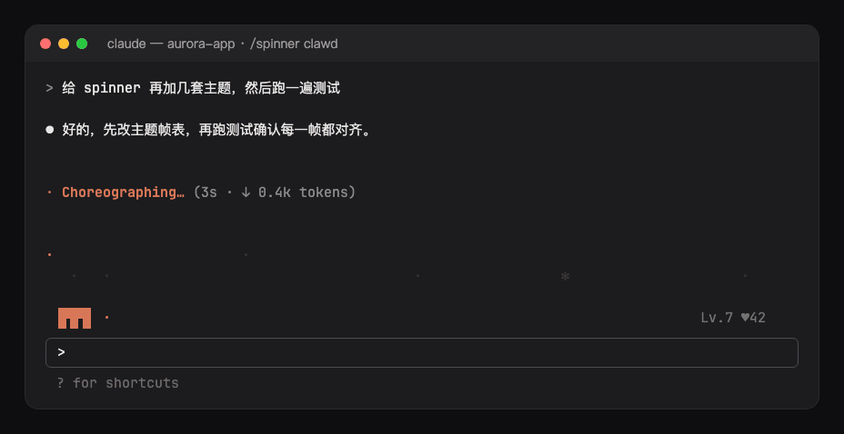

## 功能

- **动画小剧场**：Claude 工作时，输入框上方播放主题动画。其他 mod 的横条（hud、ts-band、hitokoto 等）排在它下面。
- **宠物伴侣**：参考 Codex Pets，按思考、调用工具、输出、等待切换姿势。气泡只说 Claude Code 自己的 Spinner 行没有的信息：正在跑的工具（`Bash: npm test`、`Edit: themes.ts`），或者有权限请求在等你确认；模型思考时它就埋头忙。多个子代理并行时显示数量（`Agent ×3`），只有一个时显示它的任务。Claude 跑测试或提交时，它会说几秒钟（测试通过、测试没过、提交好了）。
- **养成**：两轮之间宠物留在原地（完成、被中断、出错，安静 5 分钟后打瞌睡）。每跑完一轮、每次测试通过、每次提交都会涨经验升级（`Lv.4`）；点它或输入 `/showtime pet` 可以摸摸它（`♥12`，会冒爱心）。等级和好感度跨会话保存，同时开的几个会话养的是同一只。
- **信息栏**：宠物旁边显示这一轮在做什么，不花一个 token：只读任务工具（TaskCreate、TaskUpdate、TaskList、TodoWrite）的结果和引擎自己的事件。等级那一行接着显示计划进度（`Lv.3 ♥12 · 1/4 ▮▮▯▯▯▯▯ 2m 14s`：完成数/总数、进度条、当前任务用了多久），下一行是当前任务（`▸ Write the feed`，没有进行中的就显示 `▹` 下一个待办）；横条下方一行列出正在跑的子代理和它手上的工具（`⤷ reviewer · review the diff (Grep)  │  checker · run the tests`），放不下的计数（`+2 个`）。宠物缩成一行时，等级后面保留 `1/4`。一轮结束全部清空。`/showtime feed off` / `on` 或 `feed` 选项可以关掉和打开；宠物不受影响。
- **Spinner 行上的吉祥物**：关掉宠物后，吉祥物会站到 Claude Code 自己的 Spinner 行前面（`[◉_◉]⊃━━ ✢ Choreographing… (4s · ↓ 14 tokens)`），原来的提示词、用时和 token 数不变。同一时间只显示一个吉祥物。
- **完成庆祝**：一轮结束后 3 秒，吉祥物身边放彩带并显示用时（`(=^▽^=)ﾉ  完成 · 12s`）；被中断是一张难过的脸，出错是一阵故障闪烁。
- **减少动画**：打开 `reducedMotion` 后，所有动画都只画静止的一帧，但仍会随 Claude 的状态变化。

## 主题

像素风场景，三行半格像素：

- `clawd`：Claude Code 的吉祥物 Clawd 散步路过，停下来干活，身边转着 Claude 的星芒；跑工具时敲笔记本，等你确认时头上冒 `?`。
- `thunder`：雷霆战机式横版射击，战机自动瞄准一波波敌机，有爆炸和计分；跑工具时敌机来得更快。
- `chomp`：吃豆人被四只幽灵追着跑，直到吞下能量豆。
- `sparky`：电气鼠一路冲过去，脸颊噼啪放电，跑工具时落下闪电。
- `bluecat`：蓝色机器猫戴着竹蜻蜓飞，跑工具时口袋里掉出道具。
- `nyan`：彩虹猫拖着彩虹飞过星空。
- `stack`（落块）：方块在井口上方悬停，跑工具时落进井里；完成的任务堆成一行行，测试失败整堆倾倒。
- `plumber`（水管工）：平台跳跃小人原地蹦跳，山丘、砖块和水管从身后滚过；跑工具时他奔跑并跳过水管；完成的任务把 ? 砖变成转动的金币，全部完成时旗杆滑入。
- `snake`（贪吃蛇）：方格蛇在点阵场地上绕着 8 字爬行，每完成一个任务就长一格；跑工具时前方出现一个苹果，它追上去吃掉；测试失败它咬到自己的尾巴，测试通过出现一个金苹果。
- `launch`（火箭发射）：海边发射台上的火箭，头顶倒计时，随任务完成逐步升高，塔架上的灯是任务；跑工具时发动机点火、焰色随工具变（bash 全功率喷射带烟），子代理是助推器；测试失败火箭坠入水中溅起水花，提交成功卫星绕船身入轨。
- `frogger`（青蛙过河）：青蛙从草岸出发，每完成一个任务就跳过一条车道，卡车、汽车和圆木从旁漂过；跑工具时它原地蹦跳，测试失败被压扁，提交时出现一片荷叶和一只苍蝇，它伸出舌头去捉。
- `kitchen`（厨房）：瓷砖墙前厨师守着灶台，锅里冒着蒸汽；完成的任务是柜台上端出的盘子，跑工具时锅按工具的颜色沸腾（bash 时冒火），每个子代理是一位切菜的副厨，测试失败灶台起火，提交时铃响、一盘菜端出去。
- `railway`（火车）：蒸汽火车原地冒烟，山丘和桥从身后滚过；跑工具时车轮转动、烟带工具的颜色；每完成一个任务就装满一节车厢，等待许可时信号臂落下，测试失败急刹冒火花，提交时穿过一条隧道。
- `garden`（花园）：栅栏前的一排花坛，天上飘着云，大花旁有只蝴蝶扑翅；每个任务是一颗种子，完成时发芽开花；跑工具时下起工具颜色的雨，每个子代理是一只嗡嗡的蜜蜂；测试失败花朵枯萎低头，提交时大花绽放、花瓣飘散。
- `racetrack`（赛车场）：彩旗飘扬、观众欢呼的椭圆赛道，领头赛车守着内线，路肩和看台从身旁掠过；跑工具时车轮转得更快（扬起尘土，尾气带工具的颜色，bash 时喷火），每个子代理是一辆跟在后面的赛车，圈数牌记录任务，等待许可时进站停在顶棚下，测试失败原地打转冒烟，全部完成时挥动方格旗，提交时撒下彩纸。
- `aquarium`（水族箱）：水草在后面摇摆，一条小丑鱼游过，气石冒着泡；每个任务是沙里的一颗珍珠，完成时宝箱打开、金币浮起；跑工具时升起工具颜色的气泡帘，每个子代理是一条鱼，思考时一只蜗牛爬过，测试失败水变浑、鱼群乱窜，提交时潜水员打着手电下潜。
- `submarine`（潜水艇）：黄色潜水艇在深海巡航，头顶光柱飘移，鱼群和水草从海床上掠过；思考时发出声呐波，等待许可时升起潜望镜，每完成一个任务发射一枚鱼雷；跑工具时螺旋桨按工具颜色飞转（bash 时下潜更深），每个子代理是一艘护航小潜艇；测试失败艇身漏水，提交时浮出水面挂起旗帜。
- `orchestra`（管弦乐团）：紫色幕布轻轻摆动，指挥站在台上挥动指挥棒，角落里节拍器滴答作响；每个任务是一个乐谱架，完成时亮起并飘出一个音符；每个子代理是一位带着乐器入座的乐手，跑工具时舞台灯光换成工具的颜色；测试失败时镲片掉落、音符四散，提交时台下掌声响起。
- `roomba`（扫地机器人）：扫地机器人在地毯上、家具腿之间来回清扫，到墙边撞一下再掉头，上方飘着灰尘；每个任务是一粒碎屑，完成时被吃掉；跑工具时身后留下工具颜色的吸尘轨迹，每个子代理是一台在自己充电座前的小扫地机；测试失败卡在沙发底下，提交时一只猫骑着它走。
- `coffee`（咖啡馆）：咖啡师站在木吧台后、红色咖啡机旁，身后架子上摆着罐子；思考时擦吧台，跑工具时操作咖啡机（bash 时冒蒸汽，edit 时滴咖啡）；每个任务是一只玻璃杯，完成时被斟满；每个子代理是一位咖啡师；测试失败打翻杯子洒出一摊咖啡，提交时杯上浮起拉花爱心。
- `penguins`（企鹅）：一群企鹅挤在浮冰上，头顶极光闪烁，海浪滚过；思考时一起摇摆，等待授权时抬头望天，跑工具时在冰洞里钓鱼，一条工具颜色的鱼跃出水面；每个子代理是一只企鹅，每完成一个任务就有一只肚皮滑行；测试失败浮冰裂成两半，提交时一条鱼被抛起吞下。
- `ufo`（飞碟）：夜晚的农场上空悬着一只飞碟，边缘的灯一圈圈追逐闪烁，下面是谷仓和栅栏，星星眨着眼；每个任务是田里的一头牛，完成时被光束吸上天；跑工具时一道工具颜色的光束扫过田野（bash 时更宽），每个子代理是一只小飞碟；测试失败时飞碟翻滚着坠地冒烟，提交时它嗖地飞走再回来。
- `dragon`（巨龙）：红色巨龙在城堡上空绕着8字飞行，金色翅膀扇动，背后是月亮和飘动的云，主楼的火盆飘出火星；每个任务是一座塔楼，完成时窗户亮起；bash 时喷火（其他工具时鼻尖冒出工具颜色的火花），每个子代理是一只跟在后面的小飞龙；测试失败时被箭射中、一沉并冒出烟团，提交时落在主楼上咆哮。
- `samurai`（武士对决）：红月下木桥上的对决，樱花从枝头飘落到桥面，武士与对手持刀呼吸对峙；每次工具调用是一记工具颜色的斩击（bash 连斩两刀），每个任务是桥边的一盏灯笼，完成时点亮，每个子代理是一名对手（最多三名）；测试失败时他在花瓣中踉跄后退，提交时收刀行礼。
- `dungeon`（地牢探险）：三人小队在火把照亮的走廊里前行，砖墙和火把缓缓后移；每个任务是一扇门，完成时打开并亮起，每个子代理是前方的一只怪物（最多四只），工具运行时法师施放工具颜色的法术；测试失败时地刺弹出，小队向后一跳，全部完成时打开宝箱，提交时掷出一颗二十面骰。
- `necromancer`（死灵法师）：夜晚的墓地，蝙蝠飞过月亮，雾气在墓碑间飘动，戴兜帽的死灵法师手中法杖的宝珠一明一暗；每个任务是一块墓碑，完成时碑上的魂火点亮，每个子代理是一具从坟里爬出来挖土的骷髅；跑工具时他举起法杖，雾里流过工具颜色的光（bash 时闪电劈中十字架）；测试失败时骷髅散成一堆白骨，提交时他戴上巫妖王冠，雾气发出绿光。

角色场景，两行：`cat`（猫）、`bunny`（兔子）、`sakura`（樱花）、`mecha`（机甲）、`neon`（霓虹）、`dino`（小恐龙）、`ocean`（小鱼）、`matrix`（字符雨）。也可以选 `random`，每个会话随机一套。

| | |
| --- | --- |
| `clawd`<br> | `thunder`<br>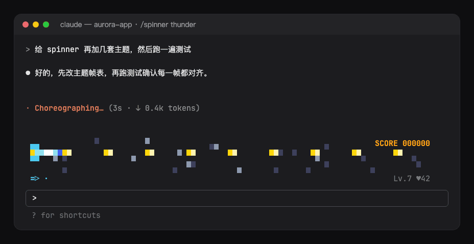 |
| `chomp`<br>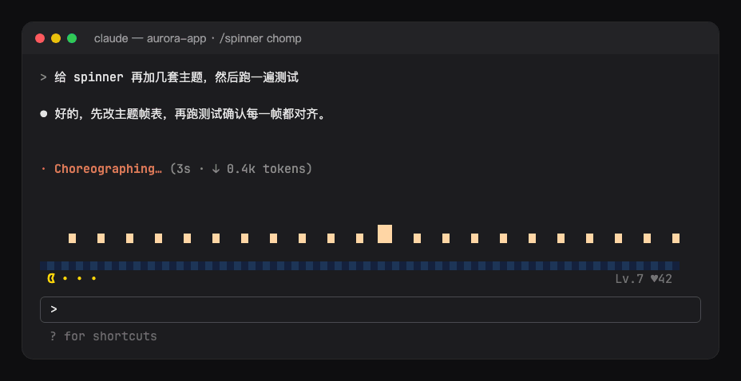 | `sparky`<br>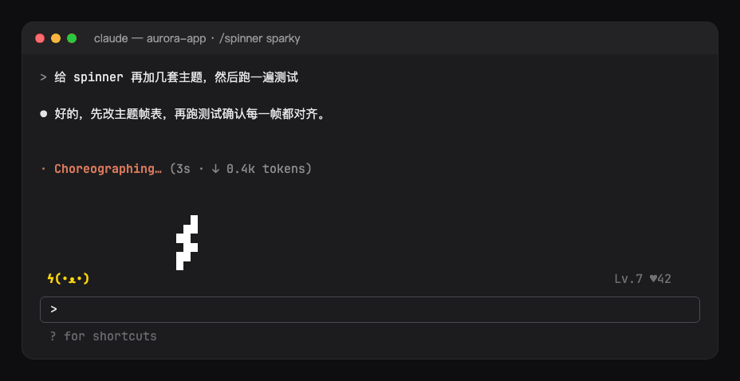 |
| `bluecat`<br>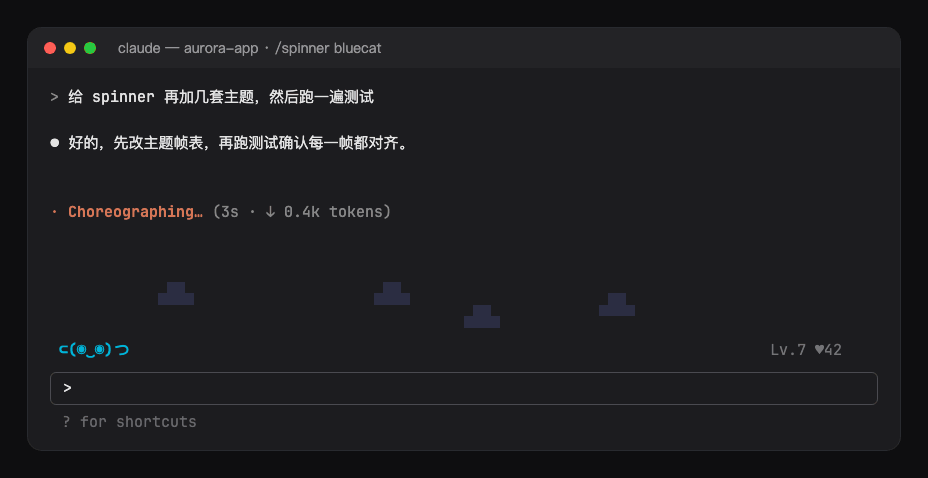 | `nyan`<br>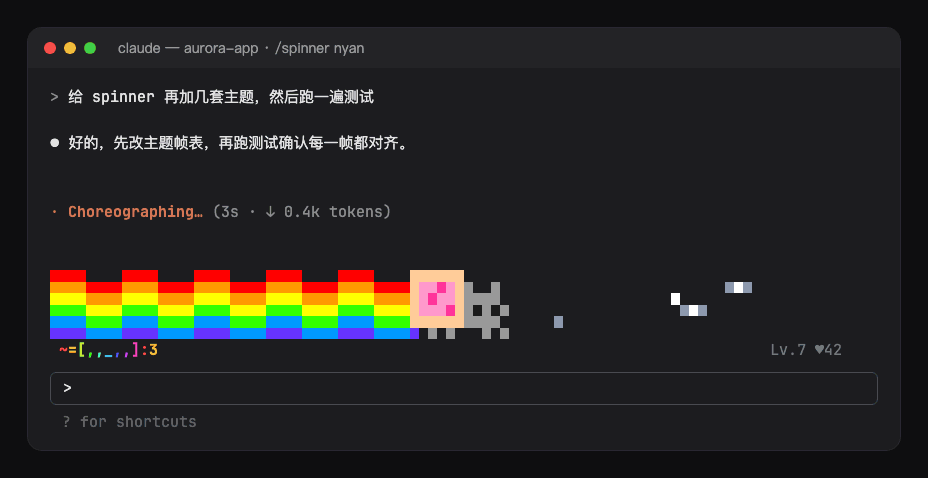 |
| `cat`<br>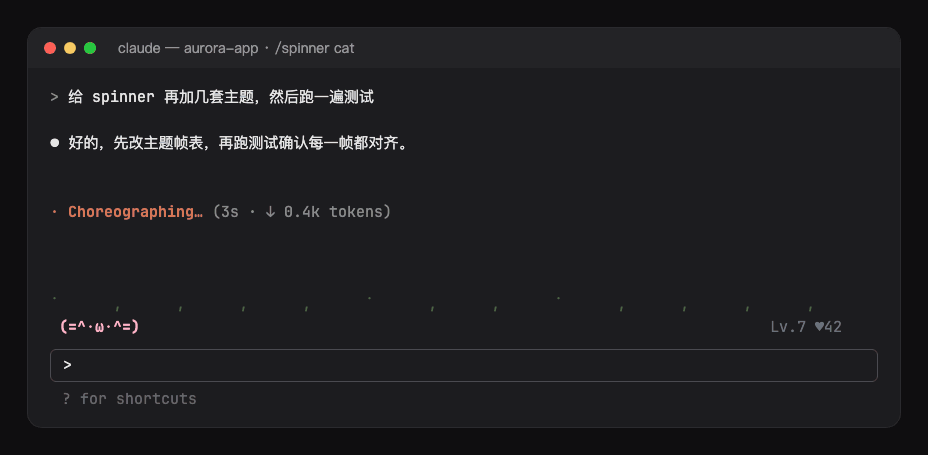 | `bunny`<br>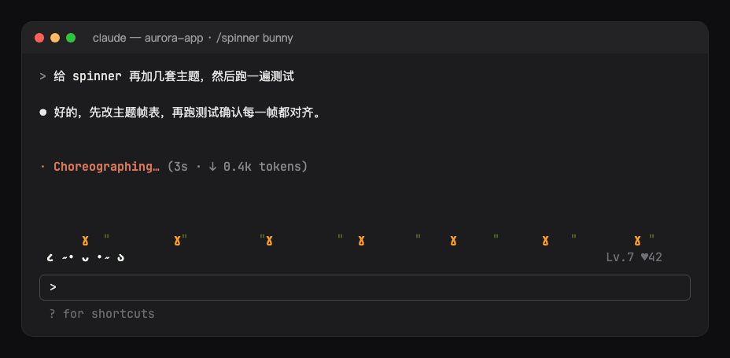 |
| `sakura`<br>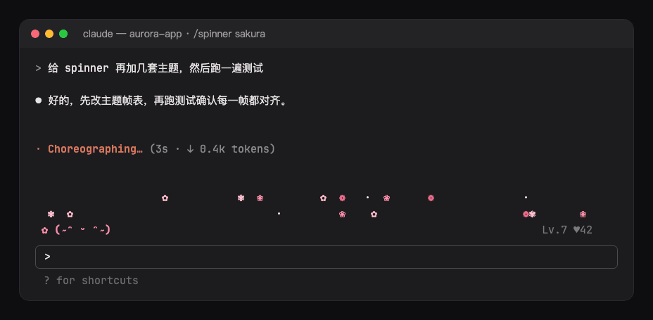 | `mecha`<br>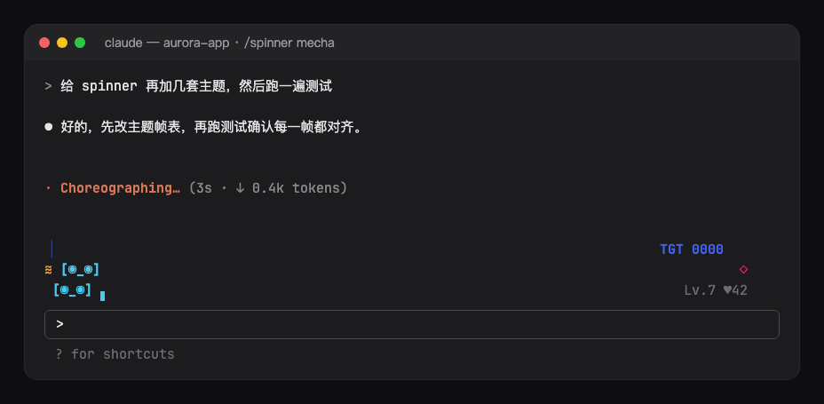 |
| `neon`<br>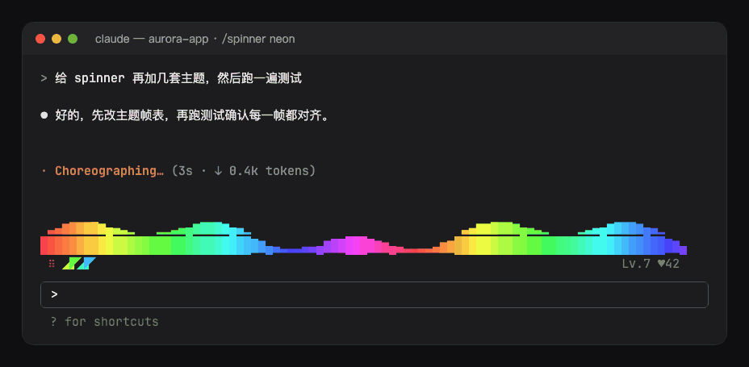 | `dino`<br>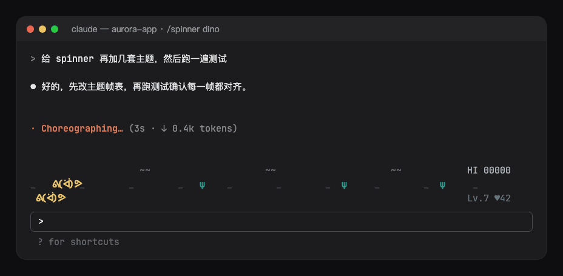 |
| `ocean`<br>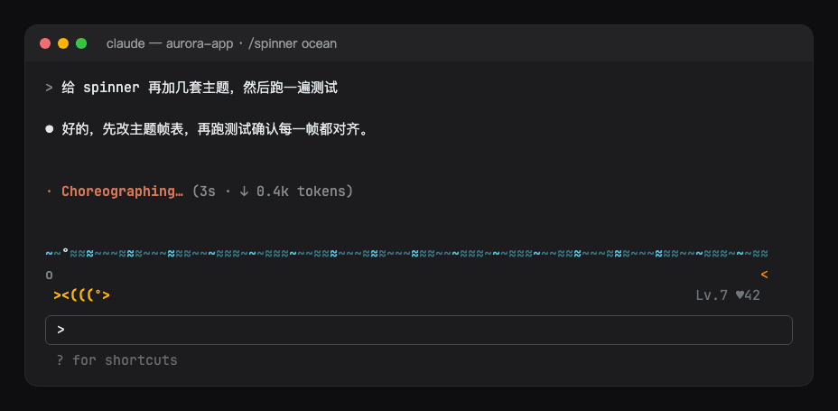 | `matrix`<br>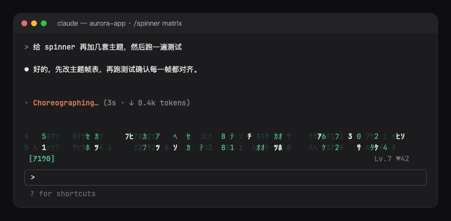 |

每套主题一行带标签的场景（工具/bash 画面）合在一张图里：[assets/gallery.png](assets/gallery.png)；每套主题的静态图在 `assets/<主题>.png`。

`chomp`、`sparky`、`bluecat`、`nyan` 是从零绘制、另起名字的同人致敬；`clawd` 照着 Claude Code 欢迎界面上的样子绘制。

## 安装

```sh
claude plugin marketplace add <path-to>/claude-mods
claude plugin install showtime@claudebro-mods
```

像素场景需要支持真彩色的终端（Ghostty、iTerm2、WezTerm、kitty 等）。

## 命令

- `/showtime`：查看当前主题、宠物的等级和好感度，以及主题列表。
- `/showtime <主题>`、`/showtime random`：立即切换主题；`/showtime theme` 弹窗选择（给出随机和三套主题，其他主题可以在 Other 里输入）。
- `/showtime preview [主题]`：在输入框上方试播 8 秒。
- `/showtime pet`：摸摸宠物。
- `/showtime off` / `on`：关闭或打开全部动画；`/showtime stage off` / `on` 只管动画场景；`/showtime companion off` / `on` 只管宠物；`/showtime feed off` / `on` 只管信息栏（任务和子代理）。

这些命令改的设置都会写回 `/config`，以后的会话也会沿用，并立即生效。选了 `random` 时，同一个会话里重新加载也不会换主题。

## 选项

在 `/config` 里修改，或写在 `~/.claude/settings.json` 的 `pluginConfigs` 里：

| 选项 | 作用 | 默认 |
| --- | --- | --- |
| `visible` | 全部动画的总开关（`/showtime off` / `on`，或输入框底栏的 **Showtime** 按钮） | 开 |
| `footerButton` | 在输入框底栏显示 **Spinner** 开关按钮 | 开 |
| `theme` | 主题 | `random` |
| `stage` | 输入框上方的动画场景 | 开 |
| `celebrate` | 一轮结束时的庆祝动画 | 开 |
| `companion` | 宠物伴侣 | 开 |
| `feed` | 宠物旁的计划进度和当前任务，横条下方的子代理一行 | 开 |
| `reducedMotion` | 吉祥物、场景和宠物只画静止画面，仍随状态变化 | 关 |
| `language` | `/showtime` 回复、宠物气泡和庆祝文字的语言：`auto`、`en`、`zh-Hans`、`zh-Hant`、`ja`、`ko`、`es`、`fr`、`de`、`pt-BR`、`ru` | `auto` |

`language` 为 `auto` 时，依次跟随 Claude Code 的 `language` 设置和系统语言环境，都没有时用英语。

Claude 工作时，横条占主题的行数再加宠物一行；两轮之间只占一行。空间不够时先收起场景、保留宠物；不足 3 行或 60 列时，宠物缩成一行（吉祥物、气泡和等级）。吉祥物、场景和宠物在终端和桌面 App 里显示；其他界面保持 Claude Code 原本的 Spinner。

## 同系列 mod

[hoobnn-agent-mods](../../README.md) 里还有状态栏 HUD（`hud`）、任务进度条（`todo-bar`）、回合回执（`receipt`）、Tailscale 节点状态（`ts-band`）和一言（`hitokoto`），可以搭配使用。

## 开发

- `hooks/register.tsx`：钩子（会话开始，回合事件：活动、庆祝、宠物，`/showtime`，Spinner 行上的吉祥物和横条）。
- `hooks/config.ts`：选项，一次性读成类型化的 `Config`。
- `hooks/command.ts`：解析 `/showtime` 的参数。
- `hooks/pet.ts`：宠物的等级和气泡、工具标签、时长。
- `hooks/themes.ts`、`hooks/cells.ts`：主题和它们绘制用的字符网格；`hooks/stage.tsx`、`hooks/sprite.tsx`：负责播放动画的 `Client` 模块。
- `hooks/i18n.ts`：各语言文案。
- `hooks/kit/`：`claude-code/kit` 的副本；改源文件后运行 `scripts/sync-kit.sh`。
- 在 mod 目录下运行 `bun scripts/shots.ts --theme <name>` 渲染该主题的静态图 `assets/<name>.png` 和审阅图 `assets/review/<name>.png`;`bun scripts/shots.ts --gallery` 渲染 `assets/gallery.png`。
